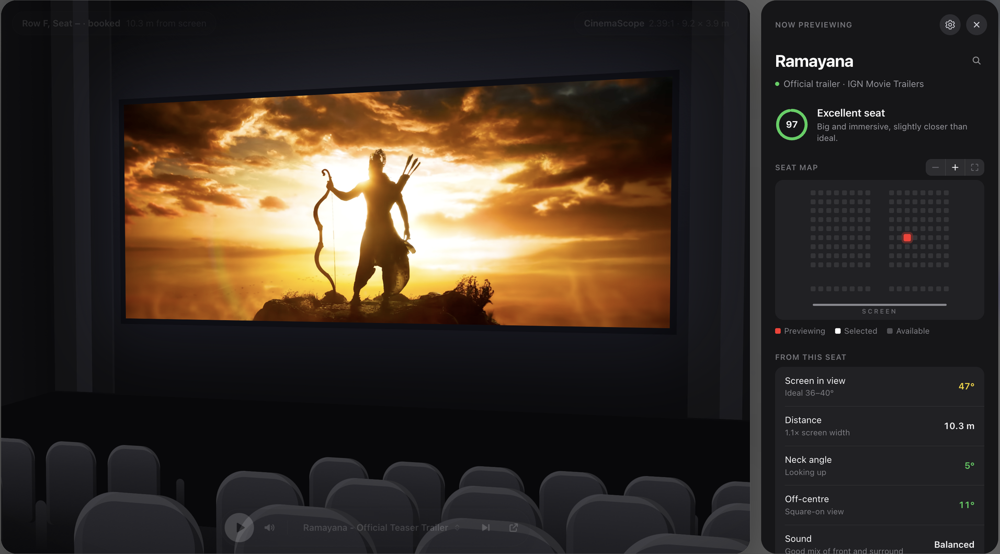
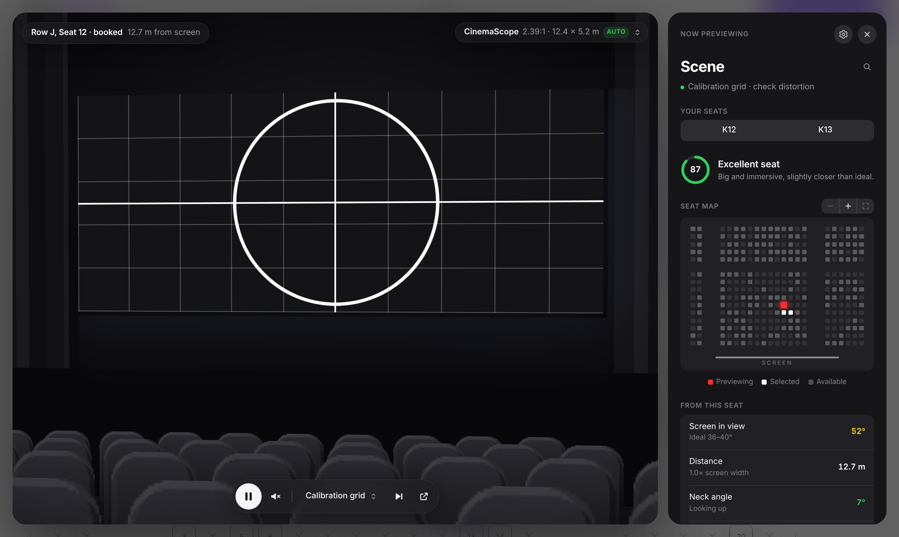
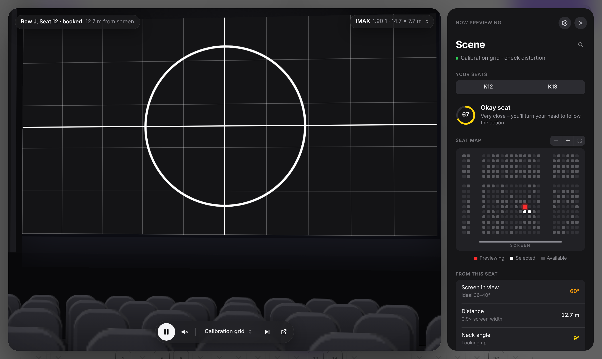
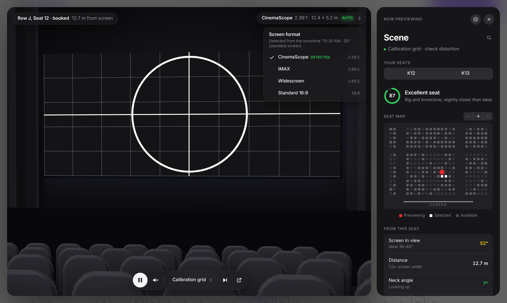
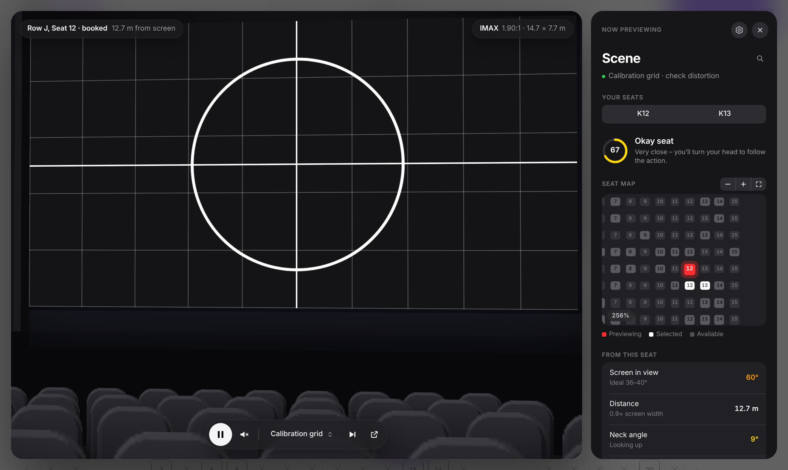
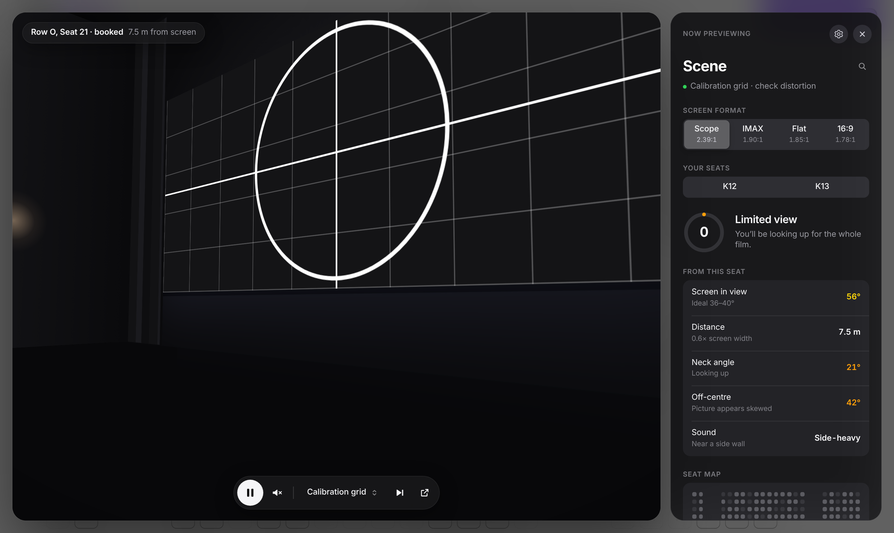
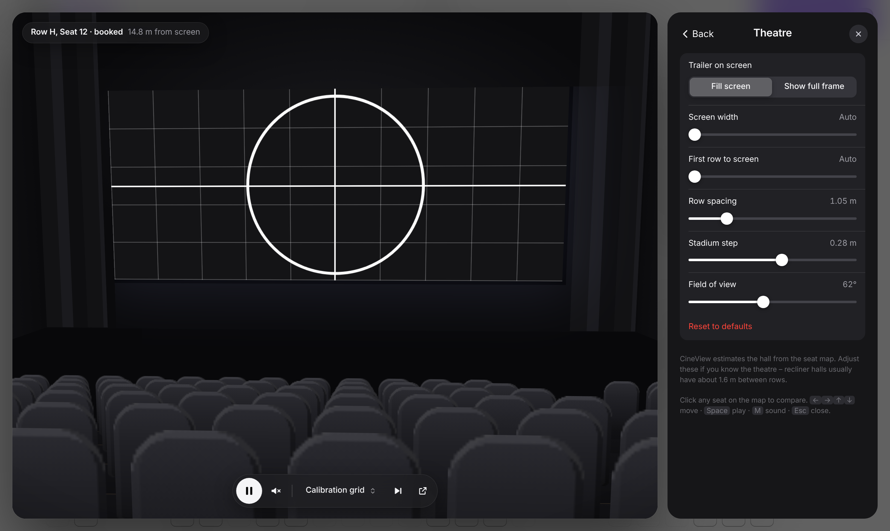
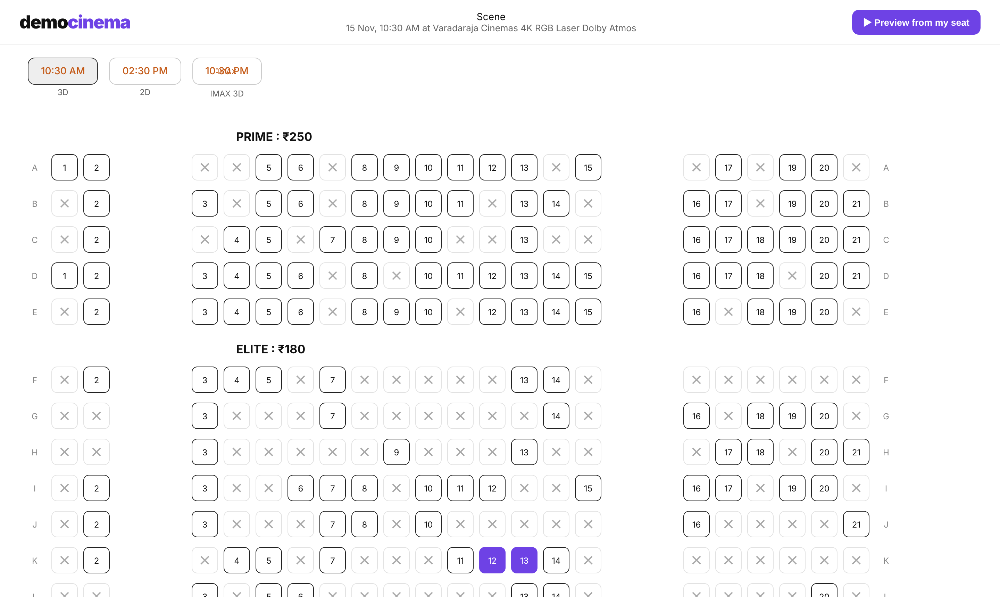
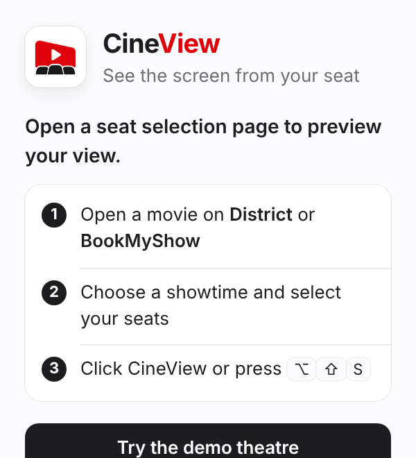

<p align="center"></p>

<h3 align="center">See the screen from your seat before you book.</h3>

<p align="center">A Chrome extension for <b>District</b> and <b>BookMyShow</b>. It turns the seat you picked into a 3D view of the hall, with the movie's own trailer playing on the screen.</p>

<p align="center"></p>
<p align="center"><sub>A real booking on District, with the movie's official teaser playing on the screen as seen from the selected seat.</sub></p>

<p align="center"><b><a href="https://cineview-ten.vercel.app">cineview-ten.vercel.app</a></b> · Current version: v2.4.2 · <a href="CHANGELOG.md">Changelog</a> · <a href="releases/">All versions</a></p>

## Why

Seat maps are flat grids. They don't show how big the screen will look, whether you'll be craning your neck in row B, or how skewed the picture gets from the far end of a row. CineView answers that before you pay.

## Features

- **Your actual seat, in 3D.** CineView reads the seat map on the page, finds the seats you selected, and places a camera at your eye height on a stepped (stadium) floor. Every seat in front of you is drawn separately.
- **The right trailer, automatically.** It detects the movie from the booking page and plays its official trailer on the cinema screen:
  1. Trailer links on District / BookMyShow are used first, after checking that the video title matches the movie.
  2. Otherwise it searches YouTube and accepts only videos whose title contains the movie name and the word *trailer* or *teaser*. Reactions, reviews, songs and game trailers are filtered out.
  3. If nothing matches, it says so instead of playing an unrelated video.
- **Real cinema formats, detected automatically.** CinemaScope 2.39:1, IMAX 1.90:1, Widescreen 1.85:1 and 16:9. CineView reads the format from the showtime you picked (for example "10:30 PM · IMAX 3D") or the cinema name, and marks it **Auto**. The dropdown at the top right of the preview shows where the format was detected and lets you switch formats; the screen animates to the new shape. IMAX gets a larger, wall-to-wall screen that starts close to the floor.
- **Seat score and viewing stats.** A 0–100 score based on how much of your view the screen fills (THX recommends about 36–40°), neck angle, off-centre angle, distance in screen widths, and where the sound is best.
- **Zoomable seat map.** Zoom in and out with the − / + buttons, pinch on a trackpad, or press + / −. Drag or two-finger scroll to pan. Seat numbers appear once you're zoomed in. Click any seat to preview it, or use the arrow keys.
- **Calibration grid.** A test pattern that makes keystone (off-centre) distortion easy to see.
- **Follows the page.** Switch movie or showtime with the preview open and it picks up the new movie and loads its trailer.

## Screenshots

| Scope 2.39:1 | IMAX 1.90:1 |
|---|---|
|  |  |

| Screen format dropdown | Zoomed seat map |
|---|---|
|  |  |

| Front row, far side | Theatre settings |
|---|---|
|  |  |

| Seat layout (demo page) | Toolbar popup |
|---|---|
|  |  |

> The demo screenshots show the calibration grid. In a real booking, the movie's trailer plays on the screen, as in the image at the top.

## Install

1. Download CineView from the website, [cineview-ten.vercel.app](https://cineview-ten.vercel.app), or get the latest zip from [`releases/`](releases/) (`cineview-v2.4.2.zip`). Unzip it. Or clone the repo: `git clone https://github.com/Bharathshiva24/CineView.git`.
2. Open `chrome://extensions` and turn on **Developer mode**.
3. Click **Load unpacked** and choose the folder that contains `manifest.json`: the unzipped `cineview-v2.4.2` folder, or `extension/` in a clone.
4. Pin **CineView** to the toolbar.

## Use

1. Open a movie on **District** or **BookMyShow**, choose a showtime and select your seats.
2. Click the CineView icon, or press **⌥ Shift S** (Alt+Shift+S).
3. Keyboard: **← → ↑ ↓** move between seats · **+ / − / 0** zoom the seat map · **Space** play/pause · **M** sound · **Esc** close.

No booking page handy? Open the popup and choose **Try the demo theatre**.

## How it works

| Part | File | What it does |
|---|---|---|
| Seat map reader | `content/detector.js` | Finds the seat grid using the most common small, square, numbered element on the page, so it doesn't depend on site class names. It groups seats into rows, finds the screen side from text like "SCREEN THIS WAY", and works out each seat's status (selected / booked / available) from ARIA attributes, class names and colours. |
| Theatre model | `content/geometry.js` | Turns a seat into a position in metres and calculates the viewing stats and score. Also defines the screen formats. |
| 3D preview | `content/overlay.js` | A CSS-3D hall inside a shadow root: screen, drapes, walls, ceiling, stepped rows and individual seats. The trailer is a real YouTube embed placed on the screen surface, so the perspective you see is the real one. |
| Movie detection | `content/main.js` | Reads the title from the booking header (the line above "15 Nov, 10:30 AM at …"), ignores hidden screen-reader text, and collects the language, screen format and any trailer links on the page. |
| Trailer matching | `background.js` | Checks trailer links from the page against the movie title, then falls back to a strictly filtered YouTube search. Results are cached for 2 days. |

## Settings

The gear icon next to Close opens **Theatre** settings: screen width, first-row distance, row spacing, stadium step, field of view, and whether the trailer fills the screen or shows the full frame. These are saved. The **Options** page has an optional YouTube Data API key and a reset button.

## Privacy

CineView runs entirely in your browser. It reads only the booking page you're on and contacts only YouTube, to find and play the trailer. There are no accounts, no analytics and no servers.

## Limitations

- Seat maps don't include real measurements, so hall dimensions are estimated. Adjust them in settings if you know the theatre (for example, recliner halls have about 1.6 m between rows).
- If a site draws its seat map on a `<canvas>`, CineView shows a typical hall and you pick your seat on the mini map.
- Browsers only autoplay video with sound off. Press the sound button to unmute.

## Project structure

```
cineview/
├── extension/            ← the Chrome extension (Load unpacked → this folder)
│   ├── manifest.json        Manifest V3
│   ├── background.js        trailer matching + keyboard shortcut
│   ├── content/             seat map reader, theatre model, 3D preview, movie & format detection
│   ├── popup/               toolbar popup
│   ├── options/             settings page
│   ├── demo/                District-style mock seat map for testing
│   └── icons/               toolbar icons + wordmark
├── website/              ← landing page, live at cineview-ten.vercel.app (Vercel redeploys on every push to main)
├── releases/             ← every version archived as a ready-to-load zip
│   ├── cineview-v2.4.2.zip  (latest)
│   ├── cineview-v2.4.1.zip
│   ├── cineview-v2.4.0.zip
│   ├── cineview-v2.3.0.zip
│   ├── cineview-v2.2.0.zip
│   ├── cineview-v2.1.0.zip
│   ├── cineview-v2.0.0.zip
│   └── seatview-v1.0.0.zip  (original prototype)
├── docs/
│   ├── logo/                wordmark + app icon (PNG + SVG)
│   └── screenshots/
├── CHANGELOG.md          ← what changed in each version
├── VERSION               ← current version number
└── README.md
```

### Versioning

- Versions use **MAJOR.MINOR.PATCH**: MAJOR for a redesign or rename, MINOR for new features, PATCH for fixes.
- Every release is tagged in git (`v2.3.0`), archived as `releases/cineview-vX.Y.Z.zip`, and described in [CHANGELOG.md](CHANGELOG.md).
- `extension/manifest.json` and `VERSION` always hold the current version. Older versions are never overwritten.
